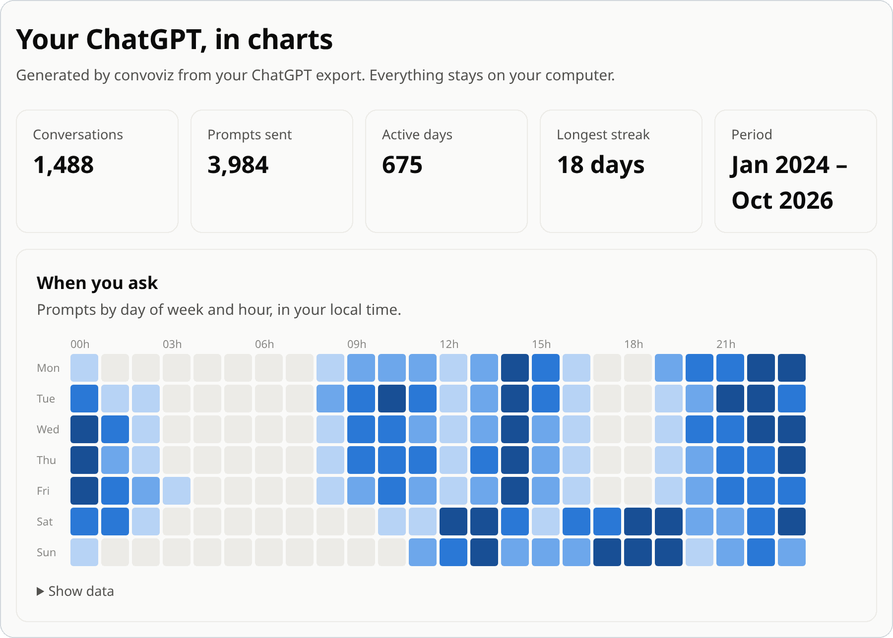
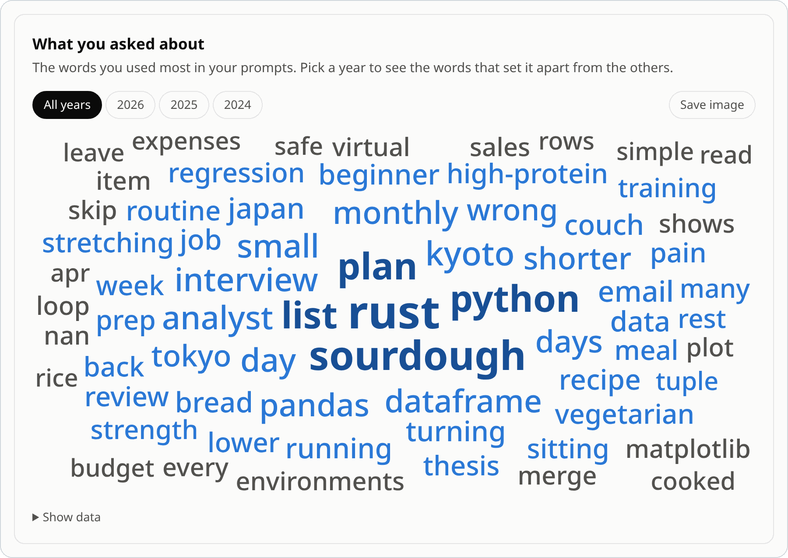
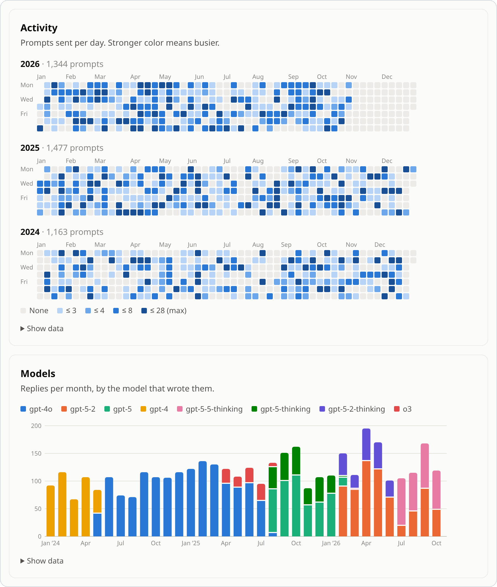

<h1 align="center">convoviz</h1>

<p align="center">
  <strong>Turn your ChatGPT export into Markdown notes and charts.</strong><br>
  Read and search your whole chat history in Obsidian or any Markdown app. Runs on your computer.
</p>

<p align="center">
  <a href="https://pypi.org/project/convoviz/"></a>
  <a href="https://pypi.org/project/convoviz/"></a>
  <a href="https://pepy.tech/projects/convoviz"></a>
  <a href="https://github.com/mohamed-chs/convoviz/actions/workflows/ci.yml"></a>
  <a href="https://obsidian.md"></a>
</p>

<p align="center">
  <picture>
    <source media="(prefers-color-scheme: dark)" srcset="https://raw.githubusercontent.com/mohamed-chs/convoviz/main/docs/assets/insights-dark.png">
    
  </picture>
  <br>
  <sub>Made from an invented export. Yours never leaves your computer.</sub>
</p>

## Quick start

**1.** In ChatGPT, open **Settings → Data controls → Export data**, and download the ZIP from the email.

**2.** Install convoviz:

```sh
# macOS / Linux
curl -LsSf https://raw.githubusercontent.com/mohamed-chs/convoviz/main/install.sh | sh
```

```powershell
# Windows (PowerShell)
powershell -ExecutionPolicy ByPass -c "irm https://raw.githubusercontent.com/mohamed-chs/convoviz/main/install.ps1 | iex"
```

**3.** Run it:

```sh
convoviz
```

It finds the newest export in Downloads and writes your archive to `Documents/ChatGPT Archive`.

<details>
<summary>New to the terminal?</summary>

Open **Terminal** (macOS: <kbd>⌘ Space</kbd>, type *Terminal*) or **PowerShell** (Windows: press <kbd>Windows</kbd>, type *PowerShell*). Paste the install line, press <kbd>Enter</kbd>, then open a new window and type `convoviz`.

The installer sets up [uv](https://docs.astral.sh/uv/), which handles Python for you. Already have uv? Run `uv tool install convoviz`.
</details>

## What you get

<table>
<tr><th>Your export</th><th>Your archive</th></tr>
<tr>
<td valign="top">

```jsonc
"n1": {
  "parent": "root",
  "message": {
    "author": {"role": "user"},
    "create_time": 1773480612.0,
    "content": {
      "content_type": "text",
      "parts": [
        "Three days in Kyoto in…"
      ]
    }
  }
},
"n2": {
  "parent": "n1",
  "message": {
    "author": {"role": "assistant"},
    "content": {
      "content_type": "thoughts",
      // … and on, for every message
```

</td>
<td valign="top">

```markdown
---
created: 2026-03-14T09:30:12
models: ["gpt-5-5-thinking"]
tags: ["chatgpt"]
---

# Planning a trip to Kyoto

## You · 2026-03-14 09:30

Three days in Kyoto in April —
what should I not miss?

## ChatGPT · 2026-03-14 09:30

<details>
<summary>Thought for 8s</summary>…

- **Fushimi Inari** early, before
  the tour groups[^1].
…
```

</td>
</tr>
</table>

- One Markdown note per conversation, sorted by year. [See a full example.](https://github.com/mohamed-chs/convoviz/blob/main/docs/example/Planning%20a%20trip%20to%20Kyoto.md)
- Sources as footnotes, reasoning and tool output folded, edited replies kept.
- Images, files and Canvas documents saved next to the notes.
- An index, and a sortable table of every conversation in Obsidian.
- `insights.html`: charts and word clouds of how you use ChatGPT, offline.

<p align="center">
  <picture>
    <source media="(prefers-color-scheme: dark)" srcset="https://raw.githubusercontent.com/mohamed-chs/convoviz/main/docs/assets/wordcloud-dark.png">
    
  </picture>
</p>

<details>
<summary>More charts</summary>
<br>
<p align="center">
  <picture>
    <source media="(prefers-color-scheme: dark)" srcset="https://raw.githubusercontent.com/mohamed-chs/convoviz/main/docs/assets/charts-dark.png">
    
  </picture>
</p>
</details>

## Updating

Run it again on a newer export. Only new and changed conversations are written. Notes you edited, moved or deleted stay as you left them (`--force` overrides that).

## Options

```sh
convoviz ~/Downloads/chatgpt-export.zip -o ~/Notes/ChatGPT
```

| Flag | |
|---|---|
| `-o PATH` | Output folder |
| `--layout flat` | All notes in one folder, not one per year |
| `--branches active` | Only the replies you last viewed |
| `--timezone Europe/Paris` | Time zone for dates |
| `--no-insights` | Skip the charts |
| `-y` | Don't ask before using the export found in Downloads |

`convoviz config init` creates a settings file for labels, tags, words to leave out of word clouds, and more.

## FAQ

<details>
<summary><strong>Is my data uploaded anywhere?</strong></summary>

No. convoviz makes no network requests, and the charts page loads nothing from the internet.
</details>

<details>
<summary><strong>Do I need Obsidian?</strong></summary>

No. The notes are standard Markdown and open in VS Code, on GitHub, or in any Markdown app. Only `Conversations.base` is Obsidian-specific.
</details>

<details>
<summary><strong>Which exports does it read?</strong></summary>

ChatGPT's 2026 format: the ZIP, an extracted folder, or `conversations.json`, including split and multi-part exports. Business and Enterprise workspaces can't export.
</details>

<details>
<summary><strong>Can I make PDFs?</strong></summary>

Yes, with [convpdf](https://github.com/mohamed-chs/convpdf): `convpdf "conversations/**/*.md" -o PDF/`.
</details>

<details>
<summary><strong>I used convoviz 0.x.</strong></summary>

1.0 writes to a new folder and leaves the old one alone. Run `convoviz config init --force` to update an old config file.
</details>

## Something wrong?

Run `convoviz inspect --json` and paste the output into a [bug report](https://github.com/mohamed-chs/convoviz/issues/new?template=bug_report.yml). It lists the export's structure only, never your conversations.

If convoviz helped you, a ⭐ helps others find it. To contribute, see [CONTRIBUTING.md](https://github.com/mohamed-chs/convoviz/blob/main/CONTRIBUTING.md). [MIT license](https://github.com/mohamed-chs/convoviz/blob/main/LICENSE).
